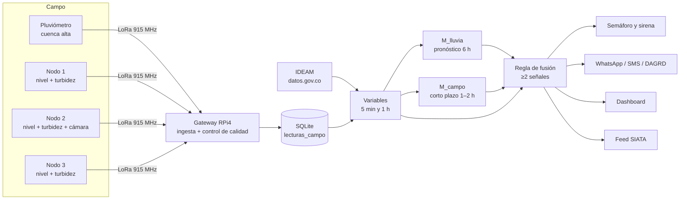

# CentineLA

Sistema de alerta temprana de crecientes súbitas para la **Quebrada La Honda**, Comuna 4 Aranjuez, Medellín.

## Autor

Bairon Nicolás Calle Rivera — estudiante de Gestión de Redes de Telecomunicaciones, ITM (Instituto Tecnológico Metropolitano), Medellín.
Proyecto individual — Territorio INN 2026, Reto #7.

---

## 1. Qué es y por qué existe

### Problema

La **Quebrada La Honda** es una microcuenca de ladera nororiental de Medellín que drena hacia el río Aburrá-Medellín a la altura de la Comuna 4 (Aranjuez). Tiene tres características que la hacen crítica:

* **Sin sistema de alerta temprana local (SAT):** no hay una red de sensores ni alarmas comunitarias dedicada al cauce.
* **Topografía vulnerable:** tramo alto (>30 % de pendiente, cabecera en el Parque Ecoturístico Arví), tramo medio (12-25 %, barrios La Honda, La Hondita, Versalles 1 y 2, El Raizal) y tramo bajo (6-12 %, Jardín Botánico, Moravia).
* **Eventos documentados:** avenidas torrenciales en **1996**, **2022** y **abril de 2026**, que afectaron el tramo medio y bajo.

El sistema **CentineLA** intenta cerrar esa brecha usando datos públicos de precipitación del IDEAM (`datos.gov.co`), un proxy hidrológico SCS-CN, modelos de Machine Learning y un dashboard de monitoreo.

### Qué resuelve

1. Consolida un proxy horario de escorrentía (`Q_scs_proxy`) a partir de estaciones pluviométricas cercanas.
2. Entrena un clasificador que, 6 h antes, estima el nivel de riesgo en tres estados: NORMAL, PRECAUCIÓN o ALERTA.
3. Simula cómo un gateway embebido (RPi4) calcularía esas features en tiempo real.
4. Expone el resultado en un dashboard de dos vistas: pública y operador/JAC.

---

## 2. Arquitectura general

```text
CUENCA ALTA                         TRAMO MEDIO                         TRAMO BAJO
(Parque Ecoturístico Arví)          (Las Granjas / La Honda)            (Parque Montecarlo / Moravia)

[Pluviómetro tipping bucket]        [Cámara IP + CV]                    [Cámara IP + CV]
 + LoRa TX                          + Sensor turbidez óptico            + Sensor turbidez óptico
                                    + Sensor ultrasónico JSN-SR04T      + Sensor ultrasónico
                                    + LoRa TX                           + LoRa TX
         │                                   │                                  │
         └───────────────────────────────────┴──────────────────────────────────┘
                                             │ LoRa 915 MHz (ISM Colombia)
                                  ┌──────────▼──────────┐
                                  │   GATEWAY           │
                                  │   Raspberry Pi 4    │
                                  │   + HAT LoRa RAK2287│
                                  │   + OpenCV          │
                                  │   + Modelo ML       │
                                  │   + Broker MQTT     │
                                  └──────────┬──────────┘
                ┌────────────────────────────┼────────────────────────────┐
                ▼ LoRa broadcast             ▼ Internet (4G backup)       │
     [Postes: LED semáforo 360° + sirena]   [WhatsApp / DAGRD si rojo]   [Feed JSON → SIATA]
                                            [Dashboard web]
```

### Componentes físicos y rol

| Componente | Rol en la arquitectura completa |
|------------|---------------------------------|
| **Nodo cuenca alta** | Pluviómetro + LoRa. Es la fuente más cercana a la cabecera; mide precipitación antes de que el pico llegue al tramo medio. |
| **Nodo tramo medio/bajo** | Cámara IP (marcas de referencia blanco/negro para OpenCV), sensor de turbidez óptico, sensor ultrasónico JSN-SR04T para nivel. Confirman el pico con múltiples fuentes. |
| **Gateway RPi4 + RAK2287** | Recibe LoRa, corre feature-engineering, modelo y decide estado. Publica alerta. |
| **Broker MQTT / WhatsApp** | Canal de alerta a la comunidad y a DAGRD. |
| **Dashboard Streamlit** | Vista pública + vista operador para JAC; consume el log del gateway y el modelo `clf_6h.joblib`. |

**Piloto de la Fase 3 (cédula):** 1 pluviómetro en la cuenca alta, 3 nodos de cauce en el tramo medio cada ~500 m (ultrasónico, turbidez, semáforo LED, sirena y panel solar; el del medio además con cámara IP) y 1 gateway en una sede comunitaria. Es lo que muestra el mapa del dashboard. Cubrir todo el cauce (6.2 km) requiere un nodo cada ~500 m. Cómo se integrarán sus datos al modelo y a la regla de alerta: §10.

> En el repositorio actual, la capa física aún no está implementada. Lo que existe es la **línea de datos IDEAM → proxy → ML → gateway simulado → dashboard**.

---

## 3. Estructura del repositorio

```text
CentineLA/
├── .gitignore                              # Ignora venv, __pycache__, .env, datos/modelos generados y config local de IDEs
├── .env.example                            # Plantilla de variables de entorno (sin valores)
├── .streamlit/config.toml                  # Tema oscuro del dashboard
├── requirements.txt                        # Dependencias de ejecución (versiones exactas)
├── requirements-dev.txt                    # Herramientas de desarrollo: pytest, ruff
├── ruff.toml                               # Reglas de lint del proyecto (python -m ruff check .)
├── LICENSE                                 # Licencia AGPL-3.0
├── CENTINELA_CONTEXTO_TECNICO.md           # Contexto interno para asistentes de código
│
├── scripts/
│   ├── 01_buscar_estaciones.py             # Filtra catálogo IDEAM por Valle de Aburrá y rankea por distancia a La Honda
│   └── 02_pull_historico.py                # Descarga precipitación histórica/tiempo real por estación
│
├── data/
│   ├── raw/
│   │   ├── estaciones_candidatas.csv       # Salida de 01_buscar_estaciones.py (NO trackeado por .gitignore)
│   │   ├── historico_0027015290.csv        # Pajarito (NO trackeado)
│   │   ├── historico_0027015310.csv        # Metromedellín (NO trackeado)
│   │   └── historico_0027015330.csv        # Olaya Herrera (NO trackeado)
│   │
│   └── processed/                          # Trackeado para deploy
│       ├── proxy_q_la_honda.csv            # Proxy SCS-CN horario
│       ├── proxy_q_la_honda_eventos.png    # Serie completa + marcas de eventos (vacío hoy)
│       ├── dataset_6h.csv                  # Dataset de entrenamiento (horizonte 6 h)
│       ├── log_gateway_simulado.csv        # Resultado de la simulación del gateway (lo que lee el dashboard)
│       └── centinela.db                    # Copia SQLite del log para consultas externas (NO trackeado; la genera 11)
│
├── simulate/
│   ├── cuenca_la_honda_params.py           # Área, longitud, tramos, CN compuesto (dato-duro vs supuesto)
│   ├── 04_scs_cn_proxy.py                  # Construye el proxy SCS-CN
│   ├── 05_validar_proxy_eventos.py         # Valida proxy contra eventos conocidos (modo exploratorio)
│   ├── 06_etl_features.py                  # ETL de features, target y split cronológico
│   ├── 07_entrenar_modelo_6h.py            # 3 enfoques de RandomForestRegressor
│   ├── 08_clasificador_6h.py               # RandomForestClassifier: NORMAL / PRECAUCIÓN / ALERTA (modelo en producción)
│   ├── 09_gateway_simulado.py              # Gateway simulado en modo streaming
│   ├── 10_metricas_ternario.py             # Recall/precisión de los umbrales 0.30 / 0.70 (fuente de las métricas del dashboard)
│   ├── 11_actualizar_ahora.py              # Actualización en vivo desde IDEAM (botón "Actualizar ahora")
│   ├── 12_variabilidad_lluvia.py           # Diferencias de lluvia entre estaciones IDEAM (argumento del pluviómetro local, §10.1)
│   ├── reglas_alerta.py                    # Umbrales 0.30/0.70 y regla de lluvia seca (única fuente para dashboard, 09 y 10)
│   └── models/                             # Trackeado para deploy
│       └── clf_6h.joblib
│
├── dashboard/
│   ├── app.py                              # Dashboard Streamlit
│   └── _check_fixes.py                     # Script de verificación del dashboard y del simulador
│
└── tests/                                  # Pruebas automáticas (pytest)
    ├── test_append_dedup.py                # Deduplicación de la actualización en vivo
    ├── test_dashboard.py                   # Umbrales, calendario y simulador
    └── test_reglas_alerta.py               # Regla de lluvia seca y módulo compartido de umbrales
```

---

## 4. Pipeline de datos

### 4.1 `scripts/01_buscar_estaciones.py` — Buscar estaciones IDEAM cercanas

**Qué hace paso a paso:**

1. Se conecta a `www.datos.gov.co` vía `sodapy.Socrata` sin `app_token`.
2. Descarga el catálogo nacional de estaciones (`hp9r-jxuu`) filtrando `Departamento="Antioquia"`, `limit=5000`.
3. Extrae lat/lon de columnas planas (`latitud`/`longitud`) o del objeto anidado `ubicaci_n`.
4. Filtra por municipios del Valle de Aburrá.
5. Calcula distancia Haversine desde un punto de referencia fijo.
6. Ordena por distancia y exporta `data/raw/estaciones_candidatas.csv`.

**Entrada:** ninguna (solo conexión a internet).

**Salida:** `data/raw/estaciones_candidatas.csv`.

**Constantes clave (valores reales del código):**

```python
LAT_LA_HONDA = 6.271
LON_LA_HONDA = -75.564

DATASET_CATALOGO = "hp9r-jxuu"

MUNICIPIOS_VALLE_ABURRA = {
    "medellin", "medellín", "bello", "itagui", "itagüi", "itagüí",
    "envigado", "sabaneta", "la estrella", "caldas", "copacabana",
    "girardota", "barbosa",
}
```

**Decisiones de diseño:**

* El punto de referencia no es el cauce exacto, sino una aproximación del barrio Sevilla / Comuna 4 Aranjuez (`6.271, -75.564`).
* Se descargan todos los municipios del Valle de Aburrá porque “el radar/pluviometría no respeta límites municipales a esta escala” — comentario propio del script.
* Normaliza nombres de columna en minúscula porque Socrata publica el esquema en minúscula; el script tolera el campo `ubicaci_n` anidado por compatibilidad con versiones anteriores de la API.

---

### 4.2 `scripts/02_pull_historico.py` — Descargar histórico de precipitación

**Qué hace paso a paso:**

1. Recibe uno o más códigos de estación por línea de comandos.
2. Inspecciona el esquema real de los datasets:
   * `s54a-sgyg` — Precipitación histórica.
   * `ksew-j3zj` — Precipitación cuasi tiempo real.
3. Detecta automáticamente el campo de código entre candidatos como `codigoestacion`, `codigo_estacion`, `estacion`, etc.
4. Prueba varias normalizaciones del código: original, sin ceros iniciales (`lstrip("0")`) y rellenado a 10 dígitos (`zfill(10)`).
5. Descarga año por año, paginando en bloques de `page_size=5000`.
6. Si un rango anual falla, lo **bisecciona recursivamente** hasta un piso de 7 días.
7. Registra rangos que no se pudieron descargar en `data/raw/GAPS_<codigo>.txt`.
8. Dedup por `[campo_codigo, fechaobservacion, codigosensor]` (una lectura por estación + sensor + hora, la última), la misma clave que usa la actualización en vivo (`11`). Así ambos caminos producen el mismo crudo.
9. Guarda `data/raw/historico_<codigo>.csv` y, si aplica, `data/raw/tiemporeal_<codigo>.csv`.

**Entrada:** códigos de estación por CLI, por ejemplo:

```bash
python scripts/02_pull_historico.py 0027015290 0027015310 0027015330
```

**Salida:** CSVs en `data/raw/`.

**Constantes y variables clave:**

```python
DATASET_HISTORICO = "s54a-sgyg"
DATASET_TIEMPO_REAL = "ksew-j3zj"

CAMPOS_CODIGO_POSIBLES = [
    "codigoestacion", "codigo_estacion", "codigoestacacion",
    "estacion", "codigo", "codigoestac",
]

page_size = 5000
piso_dias = 7   # dentro de descarga_rango_recursiva
```

**Decisiones de diseño:**

* “No asumimos nombres de columna a ciegas, porque Socrata a veces los cambia entre datasets.”
* La descarga por años permite reanudar parcialmente sin perder todo el progreso.
* Las credenciales **no están en el código**: se leen de `.env` con `python-dotenv` (`SODAPY_APP_TOKEN`, o en su lugar `SODAPY_USERNAME` + `SODAPY_PASSWORD`). Ver §8.3.
* Si no hay datos en `s54a-sgyg` para un código, no genera un CSV vacío; advierte para evitar silencios.

**Estaciones reales descargadas en este repo:**

| Código | Nombre | Sensor canónico | Sensor QA | Rango del CSV (al 2026-10-12) |
|--------|--------|-----------------|-----------|-------------------------------|
| `0027015290` | Pajarito | 240 | — | 2016-12-31 → 2020-03-28 (suspendida) |
| `0027015310` | Metromedellín | 240 | — | 2016-12-31 → 2026-10-12 |
| `0027015330` | Olaya Herrera | 240 | 257 (desde 2024-03-11) | 2016-12-31 → 2026-10-12 |

La descarga histórica original llegó hasta 2026-07-09; desde ahí las dos estaciones activas se extienden con **Actualizar ahora** (§8.4). El 13-oct-2026 se volvió a descargar completo el histórico de Metromedellín y Olaya Herrera para reparar el CSV local de Olaya, al que una versión anterior de la actualización en vivo (antes del commit `b10cd19`) le había quitado lecturas del sensor 240 cuando coincidían con el 257 (ver §5.2). Estos metadatos están codificados en `simulate/04_scs_cn_proxy.py`, no solo en `02_pull_historico.py`.

---

### 4.3 `simulate/cuenca_la_honda_params.py` — Parámetros de la cuenca

**Qué hace:** centraliza los parámetros morfométricos e hidrológicos y calcula el CN compuesto.

**Constantes clave:**

```python
AREA_TOTAL_KM2 = 5.9
LONGITUD_CAUCE_KM = 6.2

SUPUESTO_REPARTO_AREA = {
    "alto": 0.40,
    "medio": 0.30,
    "bajo": 0.30,
}

SUPUESTO_CN_POR_TRAMO = {
    "alto": 70,   # bosque en buena condición, HSG C
    "medio": 92,  # residencial denso informal
    "bajo": 85,   # urbano mixto
}

CN = calcular_cn_compuesto()   # 81.1
```

**Cálculo real:**

```python
cn = sum(
    SUPUESTO_REPARTO_AREA[tramo] * SUPUESTO_CN_POR_TRAMO[tramo]
    for tramo in TRAMOS
)
return round(cn, 1)   # 0.40*70 + 0.30*92 + 0.30*85 = 81.1
```

**Decisiones / advertencias del propio código:**

* `AREA_TOTAL_KM2` y `LONGITUD_CAUCE_KM` son datos oficiales AMVA.
* `SUPUESTO_REPARTO_AREA` y `SUPUESTO_CN_POR_TRAMO` son **supuestos de trabajo** sin fuente oficial.
* Asume Hydrologic Soil Group C (suelos residuales/saprolíticos). El grupo real no está confirmado con estudio de suelos IGAC/IDEAM.

---

### 4.4 `simulate/04_scs_cn_proxy.py` — Proxy SCS-CN horario

**Qué hace paso a paso:**

1. **Paso 0 — Inspección:** abre cada `historico_*.csv`, detecta columnas de sensor, precipitación y tiempo, y decide el tratamiento.
2. **Paso 1 — Limpieza por estación:**
   * Para Olaya Herrera, separa el sensor QA `257` y conserva solo el sensor principal `240`.
   * Convierte `valorobservado` a numérico y `fechaobservacion` a `datetime`.
   * Elimina duplicados.
   * Agrupa por timestamp y suma.
   * Resamplea a **1 h con `sum()`** porque los datos son incrementos de pluviómetro de balde (~10 min).
3. **Paso 2 — P_basin:** concatena las tres series horarias con `join="outer"`, rellena el índice horario completo y calcula:
   * `P_basin = mean(axis=1, skipna=True)` — promedio de estaciones disponibles.
   * `n_estaciones = df.notna().sum(axis=1)` — cuántas estaciones aportan en cada hora.
4. **Paso 3 — SCS-CN:**
   * Acumula 24 h: `p_acc_24h = p_basin.rolling(window=24, min_periods=1).sum()`.
   * Enmascara la acumulación si hay menos de 12 horas válidas en la ventana.
   * Calcula `S = (25400 / CN) - 254` e `Ia = 0.2 * S`.
   * Aplica:

```python
q.loc[no_luvia] = 0.0
q.loc[lluvia] = (exceso**2) / (exceso + s)
```

5. **Paso 4 — Guarda** `data/processed/proxy_q_la_honda.csv`.
6. **Verificación obligatoria:** imprime cobertura, % NaN, % Q=0, mínimo, máximo, media y un chequeo del hueco de Metromedellín (2019-02-18 16:00 → 2019-07-26 11:00).

**Entrada:**

```python
HISTORICO_FILES = [
    DATA_RAW_DIR / "historico_0027015290.csv",
    DATA_RAW_DIR / "historico_0027015310.csv",
    DATA_RAW_DIR / "historico_0027015330.csv",
]
```

**Salida:** `data/processed/proxy_q_la_honda.csv`.

**Constantes clave:**

```python
CN = 81.1  # importado de cuenca_la_honda_params.py

STATION_META = {
    "historico_0027015290.csv": {"codigo": "0027015290", "nombre": "Pajarito",       "sensor_principal": 240},
    "historico_0027015310.csv": {"codigo": "0027015310", "nombre": "Metromedellin",  "sensor_principal": 240},
    "historico_0027015330.csv": {"codigo": "0027015330", "nombre": "Olaya Herrera",  "sensor_principal": 240, "sensor_qa": 257},
}
```

**Resultado real del proxy (última corrida):**

* `proxy_q_la_honda.csv`: 85 738 filas horarias, desde `2016-12-31 14:00:00` hasta `2026-10-12 23:00:00` (la corrida del 27-jul-2026 tenía 83 458 filas hasta `2026-07-09`; el archivo crece con cada actualización en vivo).
* Columnas: `timestamp`, `P_basin`, `P_acc_24h`, `Q_scs_proxy`, `n_estaciones_disponibles`.
* Con CN=81.1: `S ≈ 59.20`, `Ia ≈ 11.84`.

**Decisiones de diseño:**

* Se usa `sum()` en el resample porque las lecturas son **incrementos de pluviómetro** (báscula), no intensidad instantánea.
* Se promedia con `skipna=True` para no perder horas con solo 1 o 2 estaciones activas; luego el ETL decide cuáles descartar.
* El acumulado de 24 h usa `min_periods=1` pero enmascara si `validos < 12`, lo que introduce NaN en ventanas con muchos huecos.

---

### 4.5 `simulate/05_validar_proxy_eventos.py` — Validación exploratoria

**Qué hace paso a paso:**

1. Carga `data/processed/proxy_q_la_honda.csv`.
2. Si `EVENTOS_CONOCIDOS` tiene fechas externas, calcula para cada una:
   * Ventana de ±48 h.
   * Valor de `Q_scs_proxy` en el timestamp más cercano.
   * Percentil de ese valor respecto a toda la serie.
   * Umbral top 5 % (`quantile(0.95)`).
   * Bandera roja si el evento NO cae en el top 5 %.
3. Si `EVENTOS_CONOCIDOS` está vacío, advierte y omite la validación temporal.
4. Siempre grafica la serie completa con marcas verticales (aunque estén vacías) y guarda `data/processed/proxy_q_la_honda_eventos.png`.

**Entrada:** `data/processed/proxy_q_la_honda.csv`.

**Salida:** `data/processed/proxy_q_la_honda_eventos.png`.

**Constante clave:**

```python
EVENTOS_CONOCIDOS = {}
```

**Decisiones de diseño:**

* “Fechas exactas pendientes — ver PQRSD a `atencionusuario@metropol.gov.co` o fuente DAGRD directa. NO inferir de la serie propia.”
* El top 5 % se calcula sobre toda la serie; no se ajusta por estación del año.
* En el estado actual del repo no hay eventos oficiales cargados, por lo que la validación es meramente visual.

---

### 4.6 `simulate/06_etl_features.py` — ETL de features y targets

**Qué hace paso a paso:**

1. **Carga** `proxy_q_la_honda.csv`.
2. **Diagnóstico pre-filtro:**
   * Cuenta, mes a mes, cuántas horas tienen `n_estaciones_disponibles = 0, 1, 2, 3`.
   * Destaca meses donde `n=0` o `n=1` son mayoría (>50 %).
   * Cruza esos meses con dos ventanas documentadas:

```python
PAJARITO_FIN_ACTIVO         = pd.Timestamp("2020-03-28 23:59:59")
PAJARITO_SUSPENDIDO_INICIO  = pd.Timestamp("2020-03-29 00:00:00")
METROMEDELLIN_GAP_INICIO    = pd.Timestamp("2019-02-18 16:00:00")
METROMEDELLIN_GAP_FIN       = pd.Timestamp("2019-07-26 11:00:00")
```

   * Si hay meses con n<2 **fuera** de esas ventanas, los reporta como hallazgos nuevos.
3. **Filtro de calidad:** separa filas con `n_estaciones_disponibles < 2` hacia `filas_baja_calidad.csv`; el resto continúa.
4. **Base horaria:** construye un índice horario completo y rellena con NaN las horas faltantes.
5. **Features (`armar_features`):**

```python
features["P_basin"] = base_horaria["P_basin"]
features["Q_actual"] = base_horaria["Q_scs_proxy"]

for horas in (1, 3, 6, 12, 24):
    features[f"lag_{horas}h"] = base_horaria["P_basin"].shift(horas)

for horas in (1, 3, 6):
    features[f"Q_lag_{horas}h"] = base_horaria["Q_scs_proxy"].shift(horas)

for horas in (3, 6, 12, 24, 48):
    features[f"roll_sum_{horas}h"] = base_horaria["P_basin"].rolling(window=horas, min_periods=1).sum()

features["roll_max_6h"] = base_horaria["P_basin"].rolling(window=6, min_periods=1).max()
features["hora_dia"] = features.index.hour
features["mes"] = features.index.month
```

6. **Targets:** crea `target_6h`, `target_12h`, `target_24h` con `base_horaria["Q_scs_proxy"].shift(-horizonte_horas)`.
7. **Split cronológico:**
   * Si ya existe un `dataset_{h}h.csv` previo con columna `split`, **preserva el corte** para no cambiar la evaluación entre corridas. Si existe un dataset previo, el ETL conserva su corte; en la corrida del 01-oct-2026 el corte se mantuvo en 2025-07-06 16:00.
   * Si no, usa proporción **82/18** (`int(n_total * 0.82)`). Ese 82/18 se aplicó al dataset de su momento; con los datos al 2026-09-30 el corte preservado equivale a ≈80/20 (79.6 % train / 20.4 % test).
8. **Guarda** `dataset_6h.csv` (y también genera `dataset_12h.csv`, `dataset_24h.csv` y `filas_baja_calidad.csv` si se desean).

**Entrada:** `data/processed/proxy_q_la_honda.csv`.

**Salidas trackeadas:**

* `data/processed/dataset_6h.csv`

> `dataset_12h`, `dataset_24h` y `filas_baja_calidad.csv` se generan al correr el ETL; no se versionan en el repo.

**Constantes y variables clave:**

```python
HORIZONTES = (6, 12, 24)
LOW_QUALITY_MIN_ESTACIONES = 2

# Split 82/18:
corte = int(n_total * 0.82)
```

**Corrida del 27-jul-2026 (referencia histórica):**

| Métrica | Valor |
|---------|-------|
| Filas originales | 83 458 |
| Filas baja calidad (`n<2`) | 35 980 |
| Filas tras filtro | 47 478 |
| Pérdida por `dropna` de features | 3 613 |
| Pérdida adicional por `dropna` target 6 h | 797 |
| **Dataset 6 h final** | **43 068** |
| Dataset 12 h final | 42 693 |
| Dataset 24 h final | 42 200 |
| Train 6 h | 35 315 |
| Test 6 h | 7 753 |
| `% target_6h == 0` | 91.86 % |

> **Vigente al corte 2026-09-30 23:00:** dataset 6 h = 44,372 filas (train 35,316 / test 9,056). El archivo completo, con las horas posteriores al corte, tiene 44,641 filas hasta 2026-10-12 17:00.

**Decisiones de diseño:**

* El umbral `n_estaciones_disponibles >= 2` descarta horas donde solo una estación reporta, reduciendo el riesgo de usar un único sensor con falla.
* Los lags y rolling usan desplazamientos positivos (`shift(horas)`) o ventanas hacia atrás; el target usa `shift(-horas)`. Ninguna feature mira hacia adelante, evitando fuga de datos.
* El split se preserva entre corridas para mantener comparabilidad de métricas.
* Los meses lluviosos se definen como abril, mayo, octubre y noviembre en `clasificar_meses_temporada()`; esto solo sirve para el diagnóstico, no para el modelo.

**Nota sobre las fechas de hueco:**

Las constantes `METROMEDELLIN_GAP_INICIO`/`METROMEDELLIN_GAP_FIN` y `PAJARITO_SUSPENDIDO_INICIO` no se usan para **mascarar** datos; solo se usan en `diagnosticar_disponibilidad_pre_filtro()` para explicar meses con baja disponibilidad. El filtro real es `n_estaciones_disponibles < 2`.

---

## 5. Modelo predictivo

### 5.1 RandomForestRegressor — los 3 intentos descartados

`simulate/07_entrenar_modelo_6h.py` entrena y compara tres regresores contra un **baseline de persistencia** (`Q_scs_proxy` actual como predicción de 6 h futuro).

**Features usadas (18):**

```python
['P_basin', 'Q_actual',
 'lag_1h', 'lag_3h', 'lag_6h', 'lag_12h', 'lag_24h',
 'Q_lag_1h', 'Q_lag_3h', 'Q_lag_6h',
 'roll_sum_3h', 'roll_sum_6h', 'roll_sum_12h', 'roll_sum_24h', 'roll_sum_48h',
 'roll_max_6h', 'hora_dia', 'mes']
```

**Hiperparámetros comunes:**

```python
RandomForestRegressor(
    random_state=42,
    n_estimators=200,
    n_jobs=-1,
)
```

**Enfoques:**

| Enfoque | Target de entrenamiento | Peso |
|---------|------------------------|------|
| Target absoluto | `target_6h` | uniforme |
| Weighted | `target_6h` | `sample_weight = 1.0 + (y_train / y_train_max) * 20.0` |
| Delta residual | `delta_6h = target_6h - Q_actual` | uniforme; luego se reconstruye `pred_absoluta = Q_actual + pred_delta` |

**Resultados reales de la última corrida (2026-07-27):**

#### Global

| Enfoque | MAE | RMSE | R² |
|---------|-----|------|----|
| Baseline persistencia | 0.014288 | 0.139495 | 0.510524 |
| RF target absoluto | 0.036479 | 0.175972 | 0.221064 |
| RF weighted (×20) | 0.041974 | 0.207561 | -0.083693 |
| RF delta reconstruido | 0.038530 | 0.183886 | 0.149419 |

#### Subset eventos (`target_6h > 0`, n=366)

| Enfoque | MAE | RMSE | R² |
|---------|-----|------|----|
| Baseline persistencia | 0.189361 | 0.496568 | 0.600092 |
| RF target absoluto | 0.350105 | 0.613250 | 0.390074 |
| RF weighted (×20) | 0.374840 | 0.643075 | 0.329303 |
| RF delta reconstruido | 0.370445 | 0.634565 | 0.346936 |

**Por qué fallaron (según el propio código y salida):**

* El dataset tiene ~91.86 % de filas con `target_6h == 0` y solo 366 eventos (>0) en test (~4.7 %).
* RandomForest promedia hacia la media y diluye la cola de eventos.
* El script imprime explícitamente:

```text
ADVERTENCIA EXPLICITA: RF NO supera al baseline de persistencia en el subset de eventos (target_6h > 0).
```

* El baseline de persistencia es un predictor fuerte para series con alta autocorrelación horaria: si ahora hay escorrentía, en 6 h probablemente siga parecida.

**Archivos generados (NO trackeados):**

Los tres regresores se guardaban como `rf_6h.joblib` (~61 725 KB), `rf_6h_delta.joblib` (~74 161 KB) y `rf_6h_weighted.joblib` (~71 047 KB). **Ya no existen en disco**: fueron eliminados por limpieza en el commit `4b747e3`; solo se conserva `clf_6h.joblib` (el modelo en producción). Si se vuelven a necesitar, `simulate/07_entrenar_modelo_6h.py` los regenera.

---

### 5.2 RandomForestClassifier — modelo en producción

`simulate/08_clasificador_6h.py` entrena un clasificador binario (`target_6h > p90`). El dashboard (`dashboard/app.py`) y el gateway aplican a esa probabilidad la regla de lluvia seca (ver más abajo) y luego una escala ternaria, ambas definidas en `simulate/reglas_alerta.py`:

| Estado (interno) | Rango de probabilidad | Color | Lo que ve el usuario |
|------------------|----------------------|-------|----------------------|
| NORMAL | `proba < 0.30` | verde (#2ecc71) | Sin alerta |
| PRECAUCIÓN | `0.30 ≤ proba < 0.70` | amarillo (#f1c40f) | Precaución |
| ALERTA | `proba ≥ 0.70` | rojo (#e74c3c) | Alerta roja |

El código de colores es verde / amarillo / rojo. Colores y etiquetas salen de una sola fuente, `ESTADO_UI` en `dashboard/app.py` (claves `color`, `etiqueta`, etc.), y todo lo que ve el usuario usa la etiqueta: pastillas, encabezado, barra lateral, calendario, gráfico, registro y consulta. Internamente, el log y el código siguen usando NORMAL / PRECAUCIÓN / ALERTA.

**Target binario (entrenamiento):**

```python
p90 = float(train[TARGET_COL].quantile(0.90))
train["label_6h"] = (train[TARGET_COL] > p90).astype(int)
test["label_6h"]  = (test[TARGET_COL] > p90).astype(int)
```

Con la distribución actual, `p90 = 0.0`, por lo que la clase positiva equivale a `target_6h > 0`.

**Hiperparámetros exactos:**

```python
RandomForestClassifier(
    random_state=42,
    n_estimators=200,
    n_jobs=-1,
    class_weight="balanced",
)
```

**Entrenamiento (datos vigentes, corte de evaluación 2026-09-30):**

* `n train = 35 316`, `n test = 9 056`.
* Positivos train: 3 138 (8.89 %).
* Positivos test: 417 (4.60 %).

> `08_clasificador_6h.py` y `10_metricas_ternario.py` evalúan la misma ventana congelada (`FECHA_CORTE_EVALUACION = "2026-09-30 23:00"`, una prueba lo verifica); el entrenamiento no depende de esa fecha.
>
> La corrida original del 27-jul-2026 tenía `n test = 7 753` con 366 positivos (4.72 %); el reporte y el barrido de abajo son de esa corrida.

**Resultados en test con threshold por defecto (0.5) — corrida del 27-jul-2026:**

```text
              precision    recall  f1-score   support

           0   0.980514  0.980912  0.980713      7387
           1   0.611570  0.606557  0.609053       366

    accuracy                       0.963240      7753
```

**Barrido de umbrales — corrida del 27-jul-2026 (referencia histórica, dataset de 43,068 filas, criterio `proba > umbral`):**

| Umbral | Recall | Precisión | FN | FP | TP |
|--------|--------|-----------|----|----|----|
| 0.50 | 0.606557 | 0.611570 | 144 | 141 | 222 |
| 0.40 | 0.658470 | 0.539150 | 125 | 206 | 241 |
| 0.30 | 0.702186 | 0.476809 | 109 | 282 | 257 |
| 0.20 | 0.743169 | 0.400000 | 94 | 408 | 272 |
| 0.15 | 0.781421 | 0.311208 | 80 | 633 | 286 |
| 0.10 | 0.816940 | 0.256873 | 67 | 865 | 299 |

### Métricas con umbrales ternarios (vigentes, corrida del 13-oct-2026)

Criterio `proba >= umbral`, el mismo que aplican el semáforo del dashboard y el gateway simulado. Los umbrales y la regla de lluvia seca viven en un solo módulo, `simulate/reglas_alerta.py`, que importan el dashboard, `09` y `10`.

**Sistema (modelo + regla de lluvia seca) — lo que publica el dashboard:**

| Umbral | Recall    | Precisión | Rol en el sistema                |
|--------|-----------|-----------|----------------------------------|
| 0.20   | 0.752998  | 0.470060  | referencia binaria anterior      |
| 0.30   | 0.717026  | 0.576108  | PRECAUCIÓN (amarillo) o más      |
| 0.70   | 0.551559  | 0.867925  | ALERTA (rojo)                    |

**Modelo solo (probabilidad cruda, control):** 0.20 → 0.755396 / 0.405928 · 0.30 → 0.717026 / 0.491776 · 0.70 → 0.551559 / 0.855019.

**Parámetros de la corrida:** Train 35,316 filas (hasta 2025-07-06 16:00), Test 9,056 filas (2025-07-06 17:00 → 2026-09-30), 417 positivos en test (label_6h=1). Reproducible con `python simulate/10_metricas_ternario.py`, que imprime las dos tablas.

> Las métricas se calculan sobre el test hasta 2026-09-30; el dataset se extiende con las actualizaciones en vivo, pero la evaluación queda fija. Como cada actualización vuelve a correr el ETL sobre todo el proxy, los decimales pueden moverse ligeramente si cambian datos dentro de la ventana de prueba (por ejemplo, lecturas que el IDEAM publica o corrige tarde): la versión del 03-oct-2026, con criterio `>` y sin la regla, daba 0.497496 de precisión en 0.30 y el 13-oct-2026, en esas mismas condiciones, 0.496667. Ese mismo día se repararon las lecturas de Olaya Herrera perdidas por la deduplicación vieja: cambiaron 16 horas del proxy (30-sep 20:00 → 7-oct 17:00), la prueba ganó una fila (9,055 → 9,056) y la precisión del sistema pasó de 57.8 % a 57.6 % (amarillo) y de 87.5 % a 86.8 % (rojo); los recall no cambiaron.

> **Reentrenar no reproduce el modelo exacto.** `10` evalúa el modelo guardado (`clf_6h.joblib`, entrenado el 01-oct-2026), por eso sus cifras se reproducen. Si hoy se corre `08_clasificador_6h.py`, el modelo resultante no es idéntico (por ejemplo, recall 0.722 en 0.30), porque el dataset cambió un poco desde entonces. Reentrenar implica volver a correr `09` y `10` y actualizar las cifras del dashboard y de esta documentación.

**Lectura:** el amarillo avisa en más horas de riesgo (72 %) y algo más de la mitad de sus avisos (58 %) coinciden con una; el rojo detecta menos (55 %) pero 86.8 % de sus avisos coinciden con una hora de riesgo. "Hora de riesgo" = escorrentía estimada por el proxy SCS-CN a 6 h; las métricas se miden contra el proxy, no contra crecientes observadas en campo.

> **Cifras de los documentos de entrega.** La cédula, el documento técnico y la FAQ de defensa usan las cifras vigentes de la tabla de arriba (actualizadas el 14-oct-2026). Versiones anteriores de esos documentos citaban 71.5 % / 49.7 % (amarillo) y 86.1 % (rojo): la corrida del 03-oct-2026, con criterio `>` y sin la regla de lluvia seca. En "Confiabilidad del sistema", el dashboard indica la precisión del mismo modelo sin la regla (49.2 % y 85.5 %).

### Regla de lluvia seca

Si en las últimas 24 h no llovió nada (`roll_sum_24h == 0`), la probabilidad se limita a `PROBA_MAX_SIN_LLUVIA = 0.0066`, que es la frecuencia de horas de riesgo entre las 10 303 horas secas del entrenamiento (68 casos). Por qué:

* Sin lluvia previa, para que haya escorrentía a 6 h tendrían que caer unos 12 mm nuevos (la abstracción inicial con CN 81.1). Con las features disponibles, el modelo no tiene cómo anticiparlo.
* El clasificador, apoyado en `hora_dia` y `mes`, a veces marcaba PRECAUCIÓN o ALERTA en esas horas: 89 avisos en la ventana de prueba, **ninguno acertado**; en todo el histórico, 61 ALERTA y 172 PRECAUCIÓN.
* Con la regla, en los umbrales del sistema (0.30 y 0.70) no se pierde ninguna detección y la precisión sube de 49.2 % a 57.6 % (amarillo) y de 85.5 % a 86.8 % (rojo). En la referencia binaria 0.20 se pierde 1 de 417.
* El límite es 0 mm por criterio físico, no ajustado mirando el test (con 1 mm el resultado en test sería un poco mejor, pero sería elegir el umbral con los mismos datos con que se evalúa).
* Se probaron reentrenamientos (sin `hora_dia`/`mes`, con `min_samples_leaf`, con codificación cíclica): o seguían dando avisos en horas secas o cambiaban el equilibrio hacia más falsas alarmas (precisión del rojo entre 66 % y 79 %, contra 85.5 % del modelo actual). Por eso se optó por la regla y el modelo no se reentrenó.

**Observación importante sobre el recomendador automático:**

El script `08_clasificador_6h.py` tiene una función `barrer_umbrales()` que recomienda automáticamente el umbral más bajo con `recall >= 0.85`. En la corrida del 27-jul-2026 (criterio `>` de entonces) **ningún umbral en [0.1, 0.5] alcanzó ese recall**, y el script imprimió:

```text
LIMITACION A DOCUMENTAR: ningun umbral del barrido alcanza recall >= 0.85.
El maximo recall alcanzable en [0.1, 0.5] es 0.816940 con umbral=0.10
```

El dashboard expone tres niveles de alerta (NORMAL / PRECAUCIÓN / ALERTA) sobre la misma probabilidad binaria (tras la regla de lluvia seca). PRECAUCIÓN (0.30) es la zona de vigilancia: prioriza detectar (recall) y acepta más falsos positivos. ALERTA (0.70) es más exigente que el umbral binario histórico (0.20): prioriza que el rojo sea confiable (precisión). El clasificador sigue siendo **una fuente dentro de una fusión multi-sensor**, no el árbitro único.

**Feature importance del clasificador (ordenada):**

```text
roll_sum_24h: 0.206408
roll_sum_48h: 0.127721
Q_actual:     0.118186
Q_lag_1h:     0.109794
roll_sum_12h: 0.080958
hora_dia:     0.045520
Q_lag_3h:     0.045240
roll_max_6h:  0.044988
roll_sum_6h:  0.037342
mes:          0.035238
...
```

**Archivo generado (trackeado para el deploy):**

```text
simulate/models/clf_6h.joblib   # ~42 464 KB
```

### 5.3 SMOTENC

No se usó SMOTENC ni ninguna técnica SMOTE. El balanceo se hace únicamente con `class_weight="balanced"`.

---

## 6. Simulador de gateway

`simulate/09_gateway_simulado.py` replica el comportamiento que tendría un gateway RPi4 leyendo la serie fila a fila.

### Qué valida exactamente

1. **Motor de features en streaming:** calcula las mismas 18 features que `06_etl_features.py`, pero usando `collections.deque(maxlen=72)` en lugar de vectores de pandas.
2. **Sin fuga de datos:** las funciones `_lag()` y `_rolling_sum()` solo miran hacia atrás en el tiempo.
3. **Alineación batch vs streaming:** compara 500 timestamps aleatorios del `dataset_6h.csv` contra los valores calculados en streaming; tolerancia:

```python
EPSILON = 1e-6
N_VALIDACION_TS = 500
```

   Si la validación falla, el script **termina con código de salida 1 sin escribir el log**, para que `11_actualizar_ahora.py` reporte el error en vez de mostrar datos viejos como nuevos.
4. **Inferencia por micro-lotes:** procesa features en lotes de 2048 y predice con `n_jobs=1` para evitar overhead de threading.
5. **Estados (gateway y dashboard):** importados de `simulate/reglas_alerta.py`: `UMBRAL_PRECAUCION = 0.30` y `UMBRAL_ALERTA = 0.70`, con criterio `proba >= umbral`: NORMAL `< 0.30`, PRECAUCIÓN `[0.30, 0.70)`, ALERTA `≥ 0.70`. Antes de clasificar se aplica la regla de lluvia seca (§5.2). El log guarda la probabilidad del modelo (`proba_modelo`) y la final (`proba_alerta`); el dashboard vuelve a aplicar la regla (es idempotente) y recalcula el estado al cargar. (Versiones anteriores del gateway usaban un umbral binario de 0.20 y la etiqueta `ALERTA_6H`.)

### Metodología

```python
def calcular_features_streaming(base_stream):
    p_hist = deque(maxlen=72)
    q_hist = deque(maxlen=72)
    registros = []
    for row in base_stream.itertuples(index=False):
        p_hist.append(p_now)
        q_hist.append(q_now)
        feat = {
            "timestamp": ts,
            "P_basin": p_now,
            "Q_actual": q_now,
            "lag_1h": _lag(p_hist, 1),
            ...
            "hora_dia": int(ts.hour),
            "mes": int(ts.month),
        }
```

### Resultado de la última corrida (13-oct-2026, datos hasta 2026-10-12)

```text
Proxy cargado: ... | filas=85738
Dataset batch cargado: ... | filas=44641
VALIDACION OK: 500 timestamps aleatorios comparados, sin diferencias > 1e-06.
Filas inferidas (sin NaN en features): 45472
Total NORMAL: 41262
Total PRECAUCIÓN: 753
Total ALERTA: 3457
Avisos del modelo anulados por la regla de lluvia seca: 233
```

La corrida completa tarda ~15 s en un equipo de escritorio (el botón **Actualizar ahora** le da hasta 120 s).

**Distribución anual de estados:**

| Año | NORMAL | PRECAUCIÓN | ALERTA |
|-----|--------|------------|--------|
| 2017 | 6 645 | 112 | 683 |
| 2018 | 7 350 | 155 | 1 018 |
| 2019 | 3 833 | 80 | 540 |
| 2020 | 1 760 | 6 | 79 |
| 2021 | 4 609 | 43 | 222 |
| 2022 | 3 629 | 34 | 161 |
| 2023 | 481 | 6 | 68 |
| 2024 | 982 | 7 | 113 |
| 2025 | 6 677 | 131 | 311 |
| 2026 | 5 296 | 179 | 262 |

Los años con pocas horas (2020, 2023, 2024) son los de menor disponibilidad de estaciones: solo se infiere cuando hay al menos 2 estaciones y las 18 features completas.

**Salida:** `data/processed/log_gateway_simulado.csv`.

Columnas del log:

```text
timestamp,P_basin,Q_actual,Q_lag_1h,roll_sum_24h,hora_dia,mes,proba_modelo,proba_alerta,estado
```

---

## 7. Dashboard

### 7.1 `dashboard/app.py` — Aplicación Streamlit

**Header con logo y badges:** al iniciar, `render_header()` muestra el logo SVG (base64), el título "CentineLA" (con "LA" en rojo), subtítulos "Sistema integrado de vigilancia comunitaria" y "Quebrada La Honda · Comuna 4 · Medellín", y tres badges: "Prototipo activo · {etiqueta}" (Sin alerta / Precaución / Alerta roja, con su color), "Territorio INN 2026 · Reto #7", y "Datos al {fecha última lectura}".

**Apartado "¿De qué trata CentineLA?"** (`st.expander` expandido por defecto, visible en ambas vistas): tres columnas con "El problema", "Cómo funciona" y "Qué entrega", más caption de crédito del proyecto.

**Lanzamiento:**

```bash
streamlit run dashboard/app.py
```

**Datos que consume:**

* `data/processed/log_gateway_simulado.csv`
* `data/processed/proxy_q_la_honda.csv`
* `simulate/models/clf_6h.joblib`

**Constantes clave:**

```python
UMBRAL_PRECAUCION = 0.30          # de simulate/reglas_alerta.py, igual que clasificar_estado y ajustar_proba
UMBRAL_ALERTA = 0.70
PROBA_MAX_SIN_LLUVIA = 0.0066     # regla de lluvia seca
RECALL_PRECAUCION = 0.717026      # métricas del sistema, proba >= umbral (10_metricas_ternario.py)
PRECISION_PRECAUCION = 0.576108
RECALL_ALERTA = 0.551559
PRECISION_ALERTA = 0.867925
CN = 81.1                         # importado de simulate/cuenca_la_honda_params.py (simulador)
ZONA_HORARIA = "America/Bogota"   # hora y mes del simulador

N_NODOS = 5

FEATURE_COLS = [
    "P_basin", "Q_actual",
    "lag_1h", "lag_3h", "lag_6h", "lag_12h", "lag_24h",
    "Q_lag_1h", "Q_lag_3h", "Q_lag_6h",
    "roll_sum_3h", "roll_sum_6h", "roll_sum_12h", "roll_sum_24h", "roll_sum_48h",
    "roll_max_6h", "hora_dia", "mes",
]

ANCLAS = [
    {"nombre": "Cuenca Alta (Parque Arví)",      "lat": 6.2804, "lon": -75.5027},
    {"nombre": "Tramo Medio (La Honda)",  "lat": 6.2694, "lon": -75.5648},
    {"nombre": "Tramo Bajo (Moravia / Montecarlo)", "lat": 6.2781, "lon": -75.5670},
]
```

### Vista Pública

* **Estado actual de la quebrada:** semáforo con probabilidad de riesgo y línea de acción según estado (SIN ALERTA / PRECAUCIÓN / ALERTA ROJA).
* **Lluvia acumulada:** tarjetas con últimas 24 h, 7 días y 30 días (promedio de las estaciones con dato).
* **Mapa de la quebrada y sus puntos de monitoreo:** 5 nodos ilustrativos interpolados por longitud de arco entre las 3 anclas (Folium interactivo / Matplotlib estático), con leyenda debajo. No es la ubicación del piloto: la cédula define 1 pluviómetro en la cuenca alta, 3 nodos en el tramo medio (el del medio con cámara) y 1 gateway en una sede comunitaria, a ubicar con visita de campo; el pie del mapa y la FAQ lo aclaran.
* **Historial de los últimos 90 días:** cuadrícula día a día; verde = sin alerta, amarillo = hubo precaución, rojo = hubo alerta roja, **gris = sin lecturas ese día** (menos de 2 estaciones reportando; no significa "sin riesgo"). Al 2026-10-12 hay 22 días grises (25-jul → 20-ago-2026).

### Vista Operador (JAC)

* **Registro de lecturas recientes:** tabla con las últimas 100 filas de `log_gateway_simulado.csv`, la más reciente arriba, con nombres legibles y 2 decimales. La columna "Estado de alerta" muestra Sin alerta / Precaución / Alerta roja, cada una en su color.
* **Comportamiento histórico de la cuenca:** gráfico dual-axis `P_basin` / `Q_scs_proxy` con marcadores de PRECAUCIÓN (amarillo) y ALERTA (rojo); selector de rango de fechas.
* **Confiabilidad del sistema:** 4 métricas (recall/precisión para PRECAUCIÓN y ALERTA) calculadas sobre el split de test cronológico con el mismo criterio `proba >= umbral` y la misma regla de lluvia seca del semáforo; fuente `simulate/10_metricas_ternario.py`. No se recalculan en vivo. Debajo, una nota da la precisión del mismo modelo sin la regla (49.2 % y 85.5 %).
* **¿Qué factores pesan más en la alerta?:** feature importance con etiquetas legibles; expander "Detalle técnico" con info del modelo.
* **Consultar un momento específico:** selector de fecha y hora; muestra el estado como pastilla de color (Sin alerta / Precaución / Alerta roja), la probabilidad de riesgo y las features con nombres legibles. Si la fecha no tiene lecturas, lo avisa sin ocultar el simulador.
* **Simular un escenario de lluvia:** 6 controles de lluvia (última hora y acumulados de 3 a 48 h), 3 presets, botón "Simular" y semáforo de resultado (ver §7.2).

En la barra lateral están la guía del proyecto (estructura y preguntas frecuentes) y el botón **Actualizar ahora** (§8.4).

### 7.2 Simulador interactivo

Se encuentra en `_simulador_modelo()` dentro de `dashboard/app.py`; la conversión de controles a features está en `features_simulador()`.

**Controles (lluvia promedio de la cuenca, en mm; los acumulados incluyen la última hora):**

```python
_SIM_CONTROLES = [
    ("sim_p1", "Lluvia en la última hora (mm)", 40.0),
    ("sim_r3", "Lluvia acumulada 3 h (mm)", 60.0),
    ("sim_r6", "Lluvia acumulada 6 h (mm)", 80.0),
    ("sim_r12", "Lluvia acumulada 12 h (mm)", 100.0),
    ("sim_r24", "Lluvia acumulada 24 h (mm)", 120.0),
    ("sim_r48", "Lluvia acumulada 48 h (mm)", 150.0),
]
```

**3 presets exactos:**

```python
_ESCENARIOS = {
    "🌧️ Lluvia fuerte sostenida": {"sim_p1": 6.0, "sim_r3": 15.0, "sim_r6": 25.0,
                                   "sim_r12": 35.0, "sim_r24": 45.0, "sim_r48": 55.0},
    "⛈️ Aguacero puntual":        {"sim_p1": 8.0, "sim_r3": 10.0, "sim_r6": 10.0,
                                   "sim_r12": 10.0, "sim_r24": 10.0, "sim_r48": 10.0},
    "☀️ Normal":                  {todos en 0.0},
}
```

**Cómo se arman las 18 features (aproximación, documentada también en el propio dashboard):**

* Los acumulados se fuerzan a ser crecientes (1 h ≤ 3 h ≤ … ≤ 48 h). Si el usuario pone, por ejemplo, menos lluvia en 24 h que en 6 h, se igualan a la ventana más corta y el dashboard lo avisa.
* `roll_sum_3h … roll_sum_48h` = los acumulados; `P_basin` = la última hora.
* Lluvias hora a hora, repartiendo cada tramo de forma pareja: `lag_1h = (r3 − p1)/2`, `lag_3h = (r6 − r3)/3`, `lag_6h = (r12 − r6)/6`, `lag_12h = (r24 − r12)/12`, `lag_24h = (r48 − r24)/24`; `roll_max_6h = max(p1, lag_1h, lag_3h)`.
* Escorrentía con la misma fórmula SCS-CN del proxy (CN 81.1): `Q_actual = Q(r24)`; `Q_lag_h` usa el acumulado de 24 h estimado hace h horas (`r24 − lluvia de las últimas h + (r48 − r24)·h/24`).
* `hora_dia` y `mes`: la hora actual **de Colombia** (`America/Bogota`), no la del servidor.
* A la probabilidad del modelo se le aplica la regla de lluvia seca: si el acumulado de 24 h es 0, el resultado no pasa de 0.66 % y, cuando eso cambia el estado (por ejemplo, abril a las 03:00 el modelo da 0.69), el dashboard explica por qué.

> Con `hora_dia=14, mes=7` (`dashboard/_check_fixes.py`): "Lluvia fuerte sostenida" → 0.985 (**ALERTA**), "Aguacero puntual" → 0.565 (**PRECAUCIÓN**), "Normal" → 0.000 (**NORMAL**). El preset fuerte da ALERTA en cualquier hora y mes (0.94–0.995).

### 7.3 `dashboard/_check_fixes.py`

Script de verificación que:

1. Confirma que `_lluvia_acumulada()` usa `proxy["timestamp"].max()` (no la fecha del sistema) y que 24 h ≤ 7 d ≤ 30 d.
2. Confirma que `_mapa_folium()` usa `fit_bounds` y `pad = 0.015`.
3. Confirma que el calendario pinta en gris cada día sin lecturas (y que la leyenda incluye "Sin datos").
4. Confirma que existen `_simulador_modelo()` y `_ESCENARIOS` con 3 escenarios coherentes, y que los presets dan ALERTA / PRECAUCIÓN / NORMAL.
5. Confirma que acumulados incoherentes se ajustan a la ventana más corta.
6. Confirma la regla de lluvia seca: sin lluvia en 24 h, ninguna hora/mes supera el tope, y ninguna hora seca del log queda en PRECAUCIÓN o ALERTA.
7. Verifica que `vista_operador()` llama al simulador.

Las pruebas de `tests/` (pytest) cubren además el criterio `>=` de los umbrales, la regla de lluvia seca, que `09` y `10` usen el módulo compartido, el calendario, el simulador y la deduplicación de la actualización en vivo.

---

## 8. Cómo correr el proyecto desde cero

### 8.1 Entorno

Requiere **Python 3.12 o superior** (lo exigen numpy 2.5 y scipy 1.18 de `requirements.txt`); el proyecto se prueba con Python 3.14. Se recomienda crear y activar un entorno virtual en la raíz del repo (`venv/` o `.venv/`, ambos ignorados por Git):

```powershell
python -m venv venv
Set-ExecutionPolicy -Scope Process -ExecutionPolicy RemoteSigned
& venv\Scripts\Activate.ps1
```

Luego instalar dependencias. `requirements.txt` tiene las versiones exactas del entorno de entrenamiento y del dashboard; `requirements-dev.txt` agrega las herramientas de desarrollo (pytest, ruff).

```bash
pip install -r requirements.txt
pip install -r requirements-dev.txt   # solo para correr pruebas
```

### 8.2 Orden de ejecución

**Fase 1 — Extracción IDEAM (requiere internet y `.env`, ver §8.3):**

```bash
python scripts/01_buscar_estaciones.py
python scripts/02_pull_historico.py 0027015290 0027015310 0027015330
```

**Fase 2 — Pipeline de datos y modelos:**

```bash
python simulate/04_scs_cn_proxy.py
python simulate/05_validar_proxy_eventos.py
python simulate/06_etl_features.py
python simulate/07_entrenar_modelo_6h.py
python simulate/08_clasificador_6h.py
python simulate/09_gateway_simulado.py
python simulate/10_metricas_ternario.py   # métricas que muestra el dashboard
```

**Fase 3 — Dashboard:**

```bash
streamlit run dashboard/app.py
```

**Verificación:**

```bash
python dashboard/_check_fixes.py
python -m pytest -q tests
python -m ruff check .     # lint con la configuración del proyecto (ruff.toml)
```

### 8.3 Variables de entorno

El proyecto usa un archivo `.env` en la raíz del repositorio (no trackeado por Git). Hay un archivo de ejemplo trackeado:

```bash
cp .env.example .env
```

En Windows PowerShell:

```powershell
Copy-Item .env.example .env
```

Edita `.env` y completa esta variable antes de ejecutar `02_pull_historico.py` o el botón **Actualizar ahora**:

```text
SODAPY_APP_TOKEN=<tu-app-token-de-socrata>
```

En Streamlit Cloud, las mismas claves van en los *secrets* de la app (o en `.streamlit/secrets.toml` en local, también ignorado por Git); el dashboard las copia a variables de entorno al iniciar.

**Credenciales de Socrata (se requiere una de las dos opciones):**

| Variable | Script que la usa | Descripción |
|----------|-------------------|-------------|
| `SODAPY_APP_TOKEN` | `scripts/02_pull_historico.py`, `simulate/11_actualizar_ahora.py` | Token de la cuenta Socrata en datos.gov.co. Opción recomendada; basta para datos abiertos. |
| `SODAPY_USERNAME` + `SODAPY_PASSWORD` | `scripts/02_pull_historico.py`, `simulate/11_actualizar_ahora.py` | Usuario y contraseña de Socrata, solo si no usas app_token. |

`scripts/01_buscar_estaciones.py` no usa credenciales (consulta el catálogo sin app_token).

**Opcionales (prototipo IoT, futuro):**

| Variable | Uso | Descripción |
|----------|-----|-------------|
| `WIFI_SSID` | Nodos IoT (futuro) | Red WiFi del prototipo ESP32 |
| `WIFI_PASSWORD` | Nodos IoT (futuro) | Contraseña de red WiFi del prototipo |
| `UBIDOTS_TOKEN` | Nodos IoT (futuro) | Token de Ubidots para publicación MQTT |

Si no hay `SODAPY_APP_TOKEN` ni usuario/contraseña, el botón **Actualizar ahora** muestra:

```text
Falta SODAPY_APP_TOKEN en los secrets
```

### 8.4 Actualización en vivo (botón "Actualizar ahora")

El botón de la barra lateral ejecuta `actualizar_ahora()` de `simulate/11_actualizar_ahora.py`:

1. Para Metromedellín y Olaya Herrera (Pajarito está suspendida) consulta en `s54a-sgyg` solo el rango desde la última lectura guardada hasta ahora, en hora de Colombia. Si `data/raw/` no existe (caso Streamlit Cloud, donde no se versiona), parte del último timestamp del proxy menos 72 h.
2. Agrega las lecturas al CSV crudo sin duplicar por estación + sensor + timestamp.
3. Corre `04` → `06` → `09`, fusionando el proxy nuevo con el anterior para no perder el histórico. Cada paso tiene un límite de 120 s.
4. Regenera `data/processed/centinela.db` (tabla `lecturas`), una copia SQLite del log para consultas externas. **El dashboard no la lee**: lee los CSV. Si la base no existe, el dashboard la crea al iniciar; importar `11` no tiene efectos secundarios.
5. Muestra "N lecturas nuevas" o "Sin datos nuevos", la última lectura por estación y recuerda que el tablero usa la última hora con al menos 2 estaciones.

Si cualquier paso falla (incluida la validación batch vs streaming del gateway), se muestra un mensaje corto sin trazas, se conservan los datos anteriores y el botón queda en pausa 60 s; tras una actualización exitosa, la pausa es de 10 min. En el plan gratuito de Streamlit Cloud no hay disco persistente: al "despertar", la app vuelve a los CSV del repositorio.

### 8.5 Seguridad y rotación de credenciales

- **Nunca subas `.env` a Git.** Ya está incluido en `.gitignore`.
- Si sospechas que las credenciales Socrata se expusieron (por ejemplo, en un commit anterior), rótalas desde el panel de Socrata / datos.gov.co y actualiza solo tu `.env` local.
- Si trabajas en equipo, comparte los valores por un canal seguro (gestor de contraseñas, variables de CI/CD), nunca por el repositorio.

---

## 9. Limitaciones conocidas

Solo se incluyen limitaciones confirmadas por el código o los datos:

1. **Proxy regional, no local.** Las estaciones más cercanas con histórico útil (Pajarito, Metromedellín, Olaya Herrera) están a 5.7–6.7 km de La Honda. No hay estación in-situ en la quebrada.
2. **Base de eventos históricos reducida.** `EVENTOS_CONOCIDOS = {}`; no hay fechas oficiales de avenidas torrenciales cargadas para validar el proxy.
3. **CN estimado.** El CN compuesto de 81.1 depende de un reparto de área por tramo (40/30/30) y CN por tramo (70/92/85) que son supuestos de trabajo sin fuente oficial.
4. **SCS-CN aplicado como evento único sobre serie continua.** El proxy usa acumulado 24 h sin reiniciar explícitamente eventos de lluvia; es una aproximación documentada.
5. **Desbalance extremo.** Con `p90=0.0`, la clase positiva equivale a `target_6h > 0`, que representa ~8.9 % en entrenamiento y ~4.6 % en test.
6. **No hay split aleatorio; es cronológico.** El test está fijado desde `2025-07-06 17:00` en adelante. Cualquier cambio estructural en los datos recientes afecta las métricas.
7. **Recall aislado del clasificador no supera ~0.82.** En el barrido del 27-jul-2026, a umbral 0.10 se alcanzó 0.817 y a 0.20, 0.743; con los datos vigentes, a 0.20 es 0.755. El diseño asume que el clasificador será una de varias fuentes en una regla de fusión multi-sensor. El estado PRECAUCIÓN (0.30–0.70) amplía la vigilancia sin disparar la alerta máxima.
8. **Modelos y datos grandes están parcialmente versionados.** Tras la limpieza del repositorio se trackean solo `proxy_q_la_honda.csv`, `dataset_6h.csv`, `log_gateway_simulado.csv` y `simulate/models/clf_6h.joblib`; los datasets 12h/24h, `filas_baja_calidad.csv`, el modelo baseline y los archivos de `data/raw/` se regeneran o comparten por otro canal.
9. **Capa física (LoRa, sensores, cámaras) no implementada.** Solo existe el simulador y la arquitectura documentada; el diseño de integración de los datos de campo está en §10.
10. **Prototipo IoT base documentado solo como referencia.** Los issues del sketch Wokwi (credenciales WiFi expuestas, `WiFiMulti`, umbral de temperatura) no se han resuelto en este repo.
11. **El modelo, por sí solo, da avisos en horas sin lluvia; lo corrige una regla, no el modelo.** La hora del día y el mes pesan en el clasificador (~4.5 % y ~3.5 % de importancia), y en algunas combinaciones da PRECAUCIÓN o ALERTA con 0 mm en 24 h (233 avisos en el histórico, ninguno acertado en la ventana de prueba). La regla de lluvia seca (§5.2) los anula sin perder detecciones en 0.30/0.70, pero el modelo sigue sin estar calibrado en esas horas: si se reentrena, conviene evaluar quitar `hora_dia`/`mes` o regularizar los árboles, y revisar si la regla sigue siendo necesaria.
12. **Huecos de datos.** Solo se infiere cuando hay al menos 2 estaciones y las 18 features completas; si no, no hay lectura. Justo después de un hueco, los acumulados (hasta 48 h) se calculan con las horas disponibles, así que pueden subestimar la lluvia real; el ETL y el gateway lo hacen igual, así que es coherente con el entrenamiento. El calendario muestra esos días en gris (22 días entre el 25-jul y el 20-ago-2026).
13. **Los datos pueden quedar atrasados.** El tablero muestra la última lectura disponible con su fecha ("Datos al …"), pero no alerta por sí solo si esa fecha es vieja; en el plan gratuito, tras "dormirse", vuelve a los CSV del repositorio hasta que alguien pulse **Actualizar ahora**.

---

## 10. Fase 3: integración de los sensores de campo

> **Estado: diseño propuesto, no implementado.** Describe cómo entrarán al sistema los datos del piloto (1 pluviómetro en la cuenca alta, 3 nodos de cauce en el tramo medio y 1 gateway) una vez instalados. Los umbrales de campo (`N_alerta`, `N_afectación`, `V_crit`, `I_crit`) se fijan en la visita técnica.

### 10.1 Por qué los datos de campo mejoran la precisión

Hoy el sistema solo ve lluvia regional. Sus errores vienen de cuatro fuentes y cada sensor ataca una:

| Fuente de error actual | Efecto en las alertas | Qué la corrige |
|---|---|---|
| **Lluvia medida lejos de la cuenca.** Las estaciones están a 5.7–6.7 km de La Honda y la lluvia de ladera es muy local. | Falsas alarmas cuando llueve en la estación y no en la cuenca; avisos perdidos cuando el aguacero cae solo sobre la cuenca alta. | Pluviómetro propio en la cuenca alta (`P_local`). |
| **El modelo no ve el estado de la quebrada.** Su "memoria" es la escorrentía estimada (`Q_actual`, `Q_lag_*`), calculada con la misma lluvia regional. | No distingue una lluvia que encuentra el cauce en caudal base de una que llega con el cauce ya crecido. | Nivel ultrasónico (`h`, `dh/dt`) y turbidez. |
| **La etiqueta es un proxy.** "Hora de riesgo" = escorrentía SCS-CN > 0 a 6 h, con la misma lluvia regional. | La precisión publicada (57.6 % / 86.8 %) mide acuerdo con el proxy, no cuántas alertas coinciden con agua subiendo de verdad. | Nivel observado como verdad de terreno: etiqueta y métricas contra crecientes reales. |
| **CN estimado (81.1).** Un ±3.4 % en el CN mueve el umbral de escorrentía de 11.8 mm a 9.8–14.0 mm. | Umbral de "hora de riesgo" desplazado en toda la serie. | Calibración del CN con el inicio de respuesta del nivel (§10.5). |

**Evidencia en los datos actuales** (`python simulate/12_variabilidad_lluvia.py`). Se compararon las estaciones IDEAM entre sí contando solo días con las 24 h registradas y lluvia en ambas, para no confundir variabilidad real con fallas de instrumento:

| Par de estaciones | Distancia | Días con lluvia en ambas | Días en que alguna supera 11.8 mm | … en que solo una lo supera | Correlación diaria |
|---|---|---|---|---|---|
| Pajarito – Olaya Herrera | 7.4 km | 477 | 145 | 81 (56 %) | 0.63 |
| Metromedellín – Olaya Herrera | 12.3 km | 227 | 64 | 48 (75 %) | 0.29 |

La Honda queda a 5.7–6.7 km de cada estación. Si a 7–12 km la mitad o más de los días de lluvia fuerte solo una estación cruza el umbral de escorrentía, el promedio regional (`P_basin`) no puede decir con confianza si se cruzó en la cuenca. Esa incertidumbre está hoy en las features **y** en la etiqueta.

**Por qué la fusión sube la precisión.** La alerta roja confirmada exige al menos 2 señales críticas de fuentes distintas (§10.4). Si las falsas alarmas de cada fuente fueran independientes, la tasa de falsas alarmas rojas sería aproximadamente el producto:

```text
P(falsa alarma roja) ≈ P(falsa alarma del modelo) × P(señal física falsa | sin creciente)
```

Una lluvia que cae lejos de la cuenca y un objeto bajo el sensor de nivel son errores de causa distinta y rara vez coinciden. No son del todo independientes (una lluvia regional fuerte también hace más probable algo de subida), por eso el diseño usa sensores de física distinta (lluvia, nivel, turbidez, cámara) y la ganancia real se mide en campo.

**El costo es anticipación.** La confirmación física llega cuando el agua empieza a subir, así que el rojo confirmado avisa más tarde que el pronóstico de 6 h. Por eso hay dos capas: el amarillo sigue saliendo del modelo de lluvia (horas de anticipación) y el rojo exige confirmación (confiabilidad). Cuánto se gana en precisión y cuánto se pierde en anticipación se mide con los primeros eventos (§10.6); hoy no hay datos para dar una cifra honesta.

### 10.2 Flujo de datos



**Medición en el nodo (ESP32):**

* **Nivel:** el JSN-SR04T mide la distancia `d` al agua; `h = H_sensor − d`, con `H_sensor` medida en la instalación. Cada minuto toma 5 lecturas y usa la mediana (descarta ecos de gotas u hojas). La velocidad del sonido cambia ~0.18 % por °C (`c ≈ 331.3 + 0.606·T` m/s): a 2 m de altura, 10 °C de diferencia son ~3.5 cm, así que se compensa con la temperatura local. Tiene zona ciega de ~25 cm: se monta de modo que el nivel máximo esperado quede por debajo.
* **Turbidez:** lectura analógica (ADC del ESP32) promediada en 10 s. El sensor óptico económico se satura con agua muy cargada, por eso se usa su cambio relativo frente a la línea base (`turb_rel`), no NTU absolutos.
* **Lluvia:** el pluviómetro de balancín cierra un contacto por basculada (típicamente 0.2794 mm en kits de este tipo; se confirma con calibración volumétrica); el ESP32 las cuenta por interrupción con antirrebote.
* **Cámara (nodo central):** el gateway lee la regla pintada con OpenCV; confirma o invalida la lectura ultrasónica del mismo nodo, no cuenta como señal aparte.

**Transmisión (LoRa 915 MHz):** paquetes binarios de ~20 bytes (`nodo`, `secuencia`, `h_cm`, `turb`, `basculadas`, `bateria_mv`, `banderas`). Cada 5 min en condiciones normales y cada minuto si `dh/dt` o la lluvia superan un umbral: más resolución justo cuando importa y poco consumo el resto del tiempo. El número de secuencia detecta paquetes perdidos y el gateway pone la marca de tiempo al recibir (America/Bogota), así los nodos no necesitan reloj sincronizado.

**Recepción y control de calidad (gateway):** cada lectura se guarda en SQLite (`lecturas_campo`: `ts, nodo, h_cm, turb, lluvia_mm, bateria_mv, rssi, snr, qc`) y se publica por MQTT (`centinela/nodo/<id>`). Una lectura que falla el control queda marcada y **no cuenta como señal**:

| Regla | Condición | Acción |
|---|---|---|
| Rango físico | `h` fuera de `[0, H_sensor − 0.25 m]` | Descartar |
| Salto imposible | `abs(Δh)` entre lecturas mayor que la tasa máxima física (calibrada en campo) | Marcar y confirmar con la lectura siguiente |
| Valor congelado | Lectura idéntica durante horas mientras llueve en la cuenca | Sensor sospechoso. Es el tipo de falla que muestran las series IDEAM, como el hueco de 2019 de Metromedellín reportado en ceros |
| Nodo caído | Más de 15 min sin paquetes | Aviso al operador; si no queda ningún nodo válido, modo degradado (§10.4) |
| Coherencia espacial | Sube un nodo aguas abajo sin subir el de aguas arriba ni llover | Sospechoso; verificar con la cámara |
| Batería | Por debajo del umbral | Aviso de mantenimiento |

**Agregación:** dos resoluciones. 5 min para la regla de fusión (reacción rápida) y 1 h para los modelos, en la misma grilla horaria de hoy, para unirse con las features IDEAM por `timestamp`.

### 10.3 Variables nuevas

| Variable | Definición | Para qué |
|---|---|---|
| `P_local`, `P_local_roll_{3,6,12,24,48}h` | Lluvia del pluviómetro de la cuenca alta, misma construcción que `P_basin` | Lluvia donde realmente cae |
| `h_rel_<nodo>` | `h − h_base`, con `h_base` = percentil 10 de los últimos 7 días | Nivel sobre el caudal base, comparable entre nodos y temporadas |
| `dh_15min`, `dh_1h` | Cambio de `h_rel` en 15 min y en 1 h (cm/h) | Velocidad de subida, la firma de una avenida torrencial |
| `h_max_1h` | Máximo de `h_rel` en la última hora | Pico reciente |
| `turb_rel` | Turbidez / mediana de las últimas 24 h | Frente de sedimento que suele preceder la onda |
| `Q_obs` (si hay aforos) | Caudal por curva de gasto `Q = a·(h − h0)^b` | Calibrar el CN en volumen, no solo en el inicio de respuesta |

Mismas reglas que hoy: solo ventanas hacia atrás (sin fuga de datos), y el motor en streaming de `09` las calcula con `deque`, validado contra el batch con la misma tolerancia `1e-6`.

### 10.4 Regla de fusión

Señales críticas (umbrales por nodo, definidos con la regla pintada y la cota del muro en la visita técnica):

| Señal | Fuente | Condición crítica |
|---|---|---|
| Pronóstico | `M_lluvia` (modelo actual) | `p_6h ≥ 0.70`, después de la regla de lluvia seca |
| Lluvia local | Pluviómetro de la cuenca alta | Intensidad en 1 h ≥ `I_crit`, o acumulado de 24 h sobre el umbral de escorrentía calibrado |
| Nivel (por nodo) | Ultrasónico (+ cámara en el nodo central) | `h_rel ≥ N_alerta` o `dh_15min ≥ V_crit`, en 2 lecturas seguidas |
| Turbidez | Sensor óptico | `turb_rel ≥ k` (por ejemplo, 3 veces la mediana de 24 h) |

* **Sin alerta:** ninguna señal crítica y `p_6h < 0.30`.
* **Precaución:** `p_6h ≥ 0.30` o exactamente una señal crítica. Un pronóstico ≥ 0.70 sin confirmación queda aquí, marcado como "pronóstico de alerta".
* **Alerta roja confirmada:** al menos 2 señales críticas de fuentes distintas en una ventana de 30 min, una de ellas medida en el cauce (nivel o turbidez). El nivel en dos nodos distintos cuenta como dos fuentes, así una creciente evidente dispara rojo aunque el modelo no la haya visto.
* **Histéresis:** se sale del rojo solo cuando no hay señales críticas durante 30 min y `h_rel < N_alerta − margen`, para que el semáforo no parpadee en la recesión.
* **Modo degradado:** si ningún nodo pasa el control de calidad, el sistema vuelve a la escala actual (solo modelo: `p_6h ≥ 0.70` = rojo) y el tablero muestra "sin confirmación de campo". Un sensor caído nunca silencia un aviso.

Esquema de la función que se agregaría a `simulate/reglas_alerta.py` (sin la histéresis, que se aplica sobre la secuencia de estados):

```python
FUENTES_EN_CAUCE = ("nivel:", "turbidez")

def evaluar_fusion(p_6h: float, senales: set[str], hay_nodos_validos: bool) -> str:
    """senales: fuentes críticas que pasaron el control de calidad,
    p. ej. {"lluvia_local", "nivel:n2"}. p_6h ya pasó por ajustar_proba()."""
    if not hay_nodos_validos:
        return clasificar_estado(p_6h)          # modo degradado: escala actual
    criticas = set(senales)
    if p_6h >= UMBRAL_ALERTA:
        criticas.add("modelo")
    en_cauce = any(s.startswith(FUENTES_EN_CAUCE) for s in criticas)
    if len(criticas) >= 2 and en_cauce:
        return "ALERTA"
    if criticas or p_6h >= UMBRAL_PRECAUCION:
        return "PRECAUCIÓN"
    return "NORMAL"
```

### 10.5 Cómo se comporta el algoritmo con los datos nuevos

**Etapa 0 — instalación (primeras semanas).** Sin historia de nivel no se puede entrenar nada con sensores. `M_lluvia` (el clasificador actual, `clf_6h.joblib`) sigue igual y los sensores entran solo a la regla de fusión con umbrales físicos. Se registra la línea base de cada nodo (`h_base`, turbidez, ruido) y la tasa de paquetes perdidos. El sistema corre en **modo sombra**: el semáforo público sigue la escala actual, más cualquier nivel crítico medido (nunca menos protector que hoy), mientras la fusión se calcula y se guarda en paralelo para compararla.

**Etapa 1 — calibración (primera temporada de lluvias).**

1. **Representatividad de la lluvia regional:** regresión `P_local ~ P_basin` para medir cuánto se parece la lluvia del IDEAM a la de la cuenca.
2. **CN calibrado:** en cada evento se mide la lluvia local acumulada en 24 h cuando el nivel empieza a responder (abstracción inicial observada, `Ia_obs`). Como `Ia = 0.2·S` y `S = 25400/CN − 254`:

   ```text
   CN = 25400 / (254 + 5·Ia_obs)
   ```

   Con el valor actual (`Ia` = 11.84 mm) da 81.1; si la cuenca responde, por ejemplo, desde 8 mm, el CN sería 86.4. El CN calibrado recalcula el proxy de toda la serie (`04` → `06`) y se reentrena `M_lluvia`, lo que cambia todas las cifras publicadas.
3. **Etiqueta medida:** "el nivel supera `N_afectación` en las próximas h horas" reemplaza a la escorrentía estimada, así las métricas pasan a medirse contra crecientes reales.

**Etapa 2 — reentrenamiento (con decenas de eventos).** Dos modelos en lugar de uno:

* **`M_lluvia` (anticipación, 6 h):** el actual, con el CN calibrado. Es el único con 10 años de historia, así que sigue dando el amarillo con horas de anticipación.
* **`M_campo` (corto plazo, 1–2 h):** usa `h_rel`, `dh_*`, `turb_rel`, `P_local_*` y la probabilidad `p_6h` de `M_lluvia` como entrada. Con pocos eventos empieza como regresión logística de 4–5 variables (menos riesgo de sobreajuste) y pasa a Random Forest o `HistGradientBoostingClassifier` con restricciones monótonas (`monotonic_cst`: más lluvia o más nivel nunca bajan la probabilidad) cuando haya suficientes eventos.
* **Por qué no un solo modelo con NaN en los años sin sensores:** scikit-learn lo permite, pero el modelo aprendería a distinguir "época sin sensores" en vez de la física del evento.
* **Probabilidades calibradas** (`CalibratedClassifierCV` con validación temporal), para que 0.30 y 0.70 sigan significando lo mismo.
* **Validación por evento** (dejar un evento completo fuera) en vez de por hora: las horas de un mismo evento no son independientes y con pocos eventos la validación por hora sobreestima.

**Qué cambia en el comportamiento:**

* La importancia de variables se desplaza hacia el estado medido de la quebrada (`h_rel`, `dh_*`), como hoy `Q_actual` y `Q_lag_1h` suman ~23 %, pero medido y no derivado de lluvia regional. La lluvia sigue aportando la anticipación.
* La regla de lluvia seca probablemente sobre: con nivel, el modelo ya sabe que la quebrada está en caudal base. Se reevalúa con datos (§9, punto 11).

| Escenario | Hoy (solo lluvia regional) | Con sensores y fusión |
|---|---|---|
| Llueve fuerte en una estación IDEAM pero no en la cuenca | `p_6h` alto → alerta roja falsa | Sin lluvia local ni subida de nivel → precaución ("pronóstico de alerta") |
| Aguacero sobre la cuenca alta que las estaciones no registran | `p_6h` bajo → aviso perdido | Lluvia local crítica + subida de nivel → alerta roja confirmada |
| Creciente pronosticada | Rojo por pronóstico, sin confirmación | Amarillo por pronóstico con horas de anticipación; rojo confirmado cuando sube el nivel |
| Sensor con falla (congelado o caído) | No aplica | El control de calidad lo excluye; si no queda ningún nodo, modo degradado |
| Después del pico | El aviso baja cuando baja la lluvia acumulada | Histéresis: rojo hasta que el nivel baje y se mantenga 30 min |

### 10.6 Cómo se medirá la mejora

Métricas por evento, contra el nivel observado:

* **Eventos detectados:** % de eventos con rojo confirmado antes de `N_afectación`.
* **Anticipación:** mediana de minutos entre el aviso (amarillo y rojo por separado) y `N_afectación`.
* **Falsas alarmas rojas por mes.**
* **Precisión y recall horarios contra nivel real**, comparables con las cifras de hoy pero contra la realidad.
* **Disponibilidad:** % del tiempo con cada nodo válido.

Sobre los mismos eventos se comparan tres variantes: solo `M_lluvia` (hoy), solo umbrales físicos y fusión. Esa comparación, no una suposición, dice cuánto mejora la precisión.

### 10.7 Cambios previstos en el código

| Archivo | Cambio |
|---|---|
| `gateway/ingesta_lora.py` (nuevo) | Lee la radio LoRa (por USB o MQTT), decodifica, aplica el control de calidad y escribe `lecturas_campo` |
| `simulate/reglas_alerta.py` | `evaluar_fusion()`, histéresis y umbrales por nodo leídos de un archivo de configuración |
| `simulate/06_etl_features.py` | Une los agregados horarios de campo, agrega las variables de §10.3 y la etiqueta de nivel |
| `simulate/09_gateway_simulado.py` | Nuevas `deque` para nivel, turbidez y lluvia local; la validación batch vs streaming cubre las variables nuevas |
| `simulate/13_modelo_campo.py` (nuevo) | Entrena y calibra `M_campo` con validación por evento |
| `simulate/10_metricas_ternario.py` | Métricas por evento de §10.6 |
| `dashboard/app.py` | Tarjeta "Lecturas de campo" (nivel, turbidez, lluvia local, batería y estado de cada nodo) y semáforo que distingue "pronóstico" de "confirmada" |
| `tests/` | Control de calidad, tabla de verdad de la fusión, histéresis y modo degradado |

---

## 11. Licencia

Copyright (C) 2026 Bairon Nicolás Calle Rivera.
Este software se distribuye bajo la licencia **GNU AGPL-3.0** (ver [`LICENSE`](LICENSE)).
Las versiones publicadas hasta el commit `c5fc5a2` se distribuyeron bajo licencia MIT; desde 2026-10-08 el proyecto se licencia bajo AGPL-3.0.

Los datos del IDEAM se rigen por los términos de datos abiertos de [datos.gov.co](https://datos.gov.co) y no están cubiertos por esta licencia.

Para uso bajo otros términos (por ejemplo, comercial): [b41r0nn@gmail.com](mailto:b41r0nn@gmail.com).

---

## Apéndice: números de referencia rápida

| Concepto | Valor exacto | Fuente en el código |
|----------|--------------|---------------------|
| Área cuenca | 5.9 km² | `simulate/cuenca_la_honda_params.py` |
| Longitud cauce | 6.2 km | `simulate/cuenca_la_honda_params.py` |
| CN compuesto | 81.1 | `simulate/cuenca_la_honda_params.py` |
| Reparto área alto/medio/bajo | 0.40 / 0.30 / 0.30 | `simulate/cuenca_la_honda_params.py` |
| CN por tramo alto/medio/bajo | 70 / 92 / 85 | `simulate/cuenca_la_honda_params.py` |
| Mínimo estaciones | 2 | `LOW_QUALITY_MIN_ESTACIONES = 2` en `06` y `09` |
| Horizontes generados | 6, 12, 24 h | `HORIZONTES = (6, 12, 24)` en `06` |
| Split train/test | ≈80 / 20 cronológico (79.6 / 20.4; corte fijo 2025-07-06 16:00; train 35,316 filas, test 9,056 filas hasta 2026-09-30; regla inicial 82/18) | `06_etl_features.py` |
| Estaciones usadas | 0027015290, 0027015310, 0027015330 | `04_scs_cn_proxy.py` |
| Sensor canónico | 240 | `04_scs_cn_proxy.py` |
| Sensor QA Olaya | 257 | `04_scs_cn_proxy.py` |
| Sistema de alertas | NORMAL / PRECAUCIÓN / ALERTA | `dashboard/app.py` |
| Umbral PRECAUCIÓN | 0.30 | `dashboard/app.py` (`UMBRAL_PRECAUCION`) |
| Umbral ALERTA | 0.70 | `dashboard/app.py` (`UMBRAL_ALERTA`) |
| Criterio de umbral | `proba >= umbral` | `simulate/reglas_alerta.py` (lo usan dashboard, `09` y `10`) |
| Regla de lluvia seca | 24 h = 0 mm → proba ≤ 0.0066 | `simulate/reglas_alerta.py` |
| Recall / precisión del modelo solo (umbral ≥0.20, control) | 0.755396 / 0.405928 | `simulate/10_metricas_ternario.py` |
| Recall PRECAUCIÓN (umbral ≥0.30, sistema) | 0.717026 (~71.7 %) | `simulate/10_metricas_ternario.py` |
| Precisión PRECAUCIÓN (umbral ≥0.30, sistema) | 0.576108 (~57.6 %) | `simulate/10_metricas_ternario.py` |
| Recall ALERTA (umbral ≥0.70, sistema) | 0.551559 (~55.2 %) | `simulate/10_metricas_ternario.py` |
| Precisión ALERTA (umbral ≥0.70, sistema) | 0.867925 (~86.8 %) | `simulate/10_metricas_ternario.py` |
| Gateway validación | 500 timestamps, ε=1e-6 | `09_gateway_simulado.py` |
| Estados del log (NORMAL / PRECAUCIÓN / ALERTA) | 41 262 / 753 / 3 457 (45 472 horas, datos al 2026-10-12) | `09_gateway_simulado.py` |
